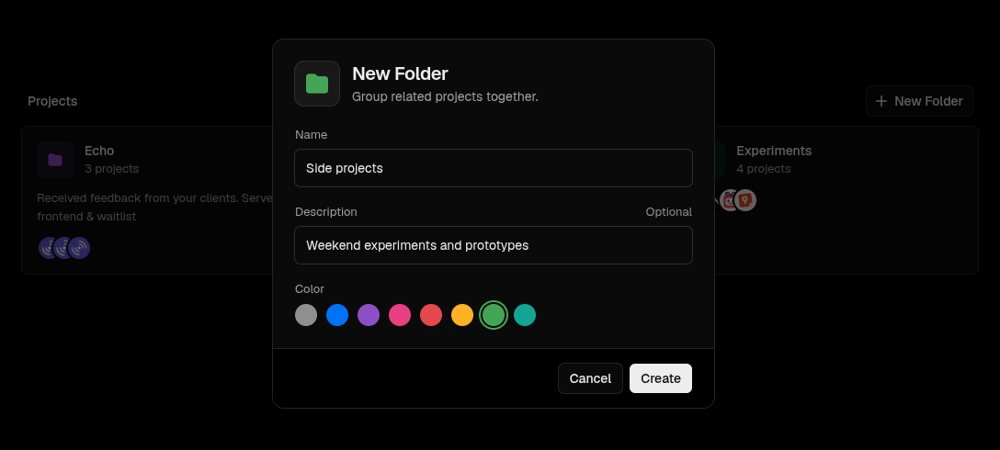

<h1 align="center">Vercel Folders</h1>
<p align="center">Organize your Vercel projects into folders.</p>

<p align="center">
  TypeScript · Bun · Chrome Extension (MV3)
</p>

<br />

A Chrome extension for the Vercel dashboard. Group related projects into
folders, drag them in, or use **Add to Folder** from the project menu.
Folders sync across your devices and can be turned off from the toolbar.

<br />



<br />

## Quick start

```bash
bun install
bun run build
```

Open `chrome://extensions`, enable **Developer mode**, click **Load unpacked** and select `dist/`.

Run `bun run dev` to rebuild on every change.

<br />

<p align="center">Not affiliated with Vercel. MIT License.</p>
