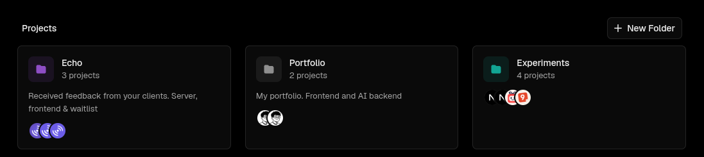

# Vercel Folders

Organize your [Vercel](https://vercel.com) projects into folders. 🗂️



When you have a lot of projects, the dashboard gets crowded fast. This Chrome extension lets you group them into folders: create one, pick a color, and drag projects in or use **Add to Folder** from the project menu. Folders sync across your devices and you can turn the extension off from the toolbar.


This isn't a product or something to copy. I just wanted to propose an idea I liked to the Vercel team, and it's been useful for me in the meantime. ✨ Not affiliated with Vercel.

## Development

```bash
bun install
bun run build
```

Open `chrome://extensions`, enable Developer mode, click **Load unpacked** and select `dist/`.

Built with TypeScript + Bun.
